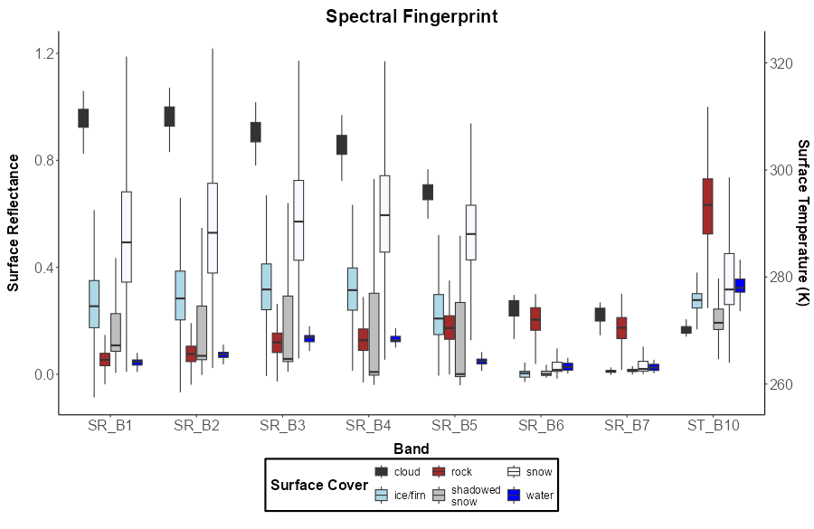

## Introduction
Around the world, glaciers are in decline [@Dyurgerov_Meier_2004]. With more than 20,000 mountain glaciers, in addition to the ice sheet, Greenland is one of the most important glaciated regions in the world. @Farinotti_Huss_2019 estimate the total potential sea level rise contribution of Greenland at over 7m, and mass loss from mountain glaciers is currently the most significant contribution to global sea level rise [@Jacob_Wahr_Pfeffer_Swenson_2012].

## Methods {#sec-methods}
### Land Cover Classification {#sec-classifier}
\acr{ML} classification of Landsat images was based on a modified version of methods published by @Aberle_Enderlin_2025. Initial training data (labeled points and images) was acquired courtesy of Aberle et al. for 4 USGS Benchmark glaciers (Gulkana, South Cascade, Sperry, and Wolverine) across a total of 7 Landsat images (two images each for Gulkana, South Cascade, and Sperry glaciers), for a total of 8,162 training points. These labeled training points were augmented with an additional 2,650 training points within Greenland, for a combined total of 10,812 training points. For Greenland training data, two locations were chosen, Mittivakkat glacier in south-east Greenland, and a heavily glaciated rocky peninsula in west-central Greenland (located at 72°N, 54°W). Additionally, the “cloud” class was added to the list of 5 landcover types from Aberle et al., bringing the total number of land cover classifications to 6, “cloud”, “ice/firn”, “rock”, “shadowed snow”, “snow”, and “water”. 

Surface reflectance Landsat 8 & 9 images were acquired for each of these training locations/dates via Google Earth Engine (GEE). Where multiple Landsat images overlapped within a 1-hour window for a single glacier (i.e. successive Landsat rows), images were merged using a median pixel value, as described by @Aberle_Enderlin_2025. For each training image five spectral indices were calculated to aid in image classification. These indices are Normalized Difference Snow Index (NDSI), Normalized Difference Glacier Index (NDGI), Normalized Difference Water Index (NDWI), Normalized SWIR Difference Soil-moisture (NSDS), and Normalized Difference Vegetation Index (NDVI). Each of these indices was tested individually and in combination with the other bands/indices and was found to aid separation of one or more of the landcover classes of interest. Surface reflectance, surface temperature, and all 5 spectral indices data were extracted from pixel data at each of the labeled training data points for both Alaska and Greenland ([Figures -@fig-fingerprint-SR; -@fig-fingerprint-indeices]). 

{#fig-fingerprint-SR fig-alt="Spectral fingerprint boxplot"}

{#fig-fingerprint-indeices fig-alt="Spectral fingerprint boxplot"}

For model training and testing a K-folds repeated cross-validation method was utilized with 10 folds, 10 repeats, and a partition (p) = 0.9 resulting in a 90/10 training/testing split, where all labeled data points are utilized in testing for exactly 1 of 10 folds/repeats. Using this training/testing framework a total of 129 distinct \acr{ML} models were tested, across 10 model types, using a hyper-parameter grid search performed in R utilizing the caret package [@Kuhn_Max_2008]. Based on the accuracy results of this training/testing model optimization process, the three best performing models were selected for additional model validation using previously unseen, spatially-temporally distant validation data. The top three, best performing models were, random forest, support vector machine (SVM) using a linear kernel, and SVM with a radial kernel.

## References {.unnumbered}

::: {#refs}
:::