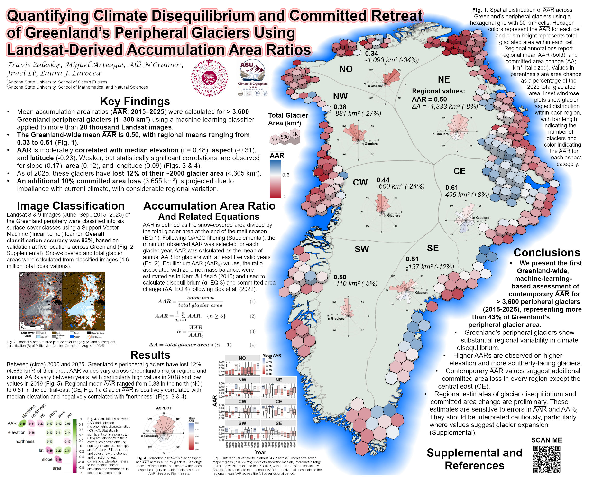
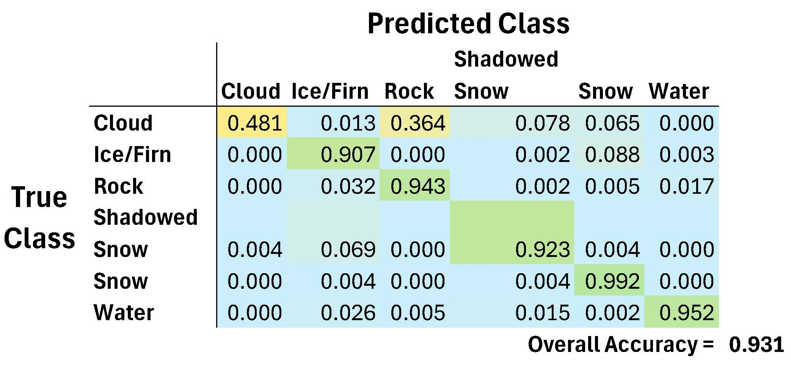
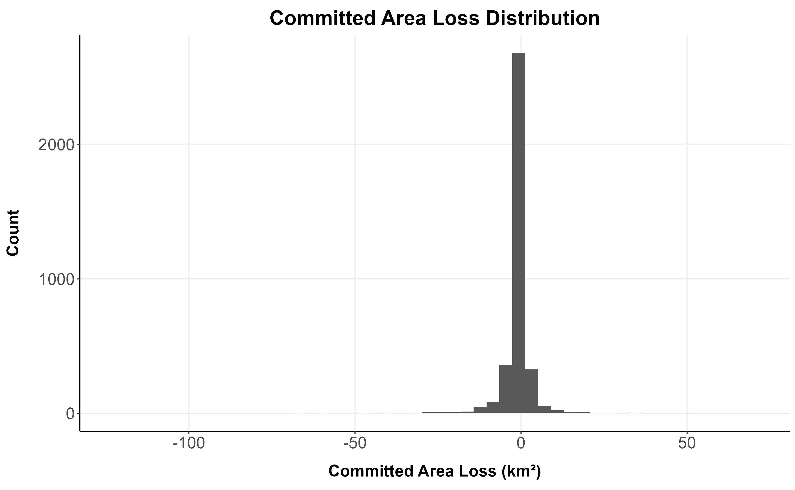
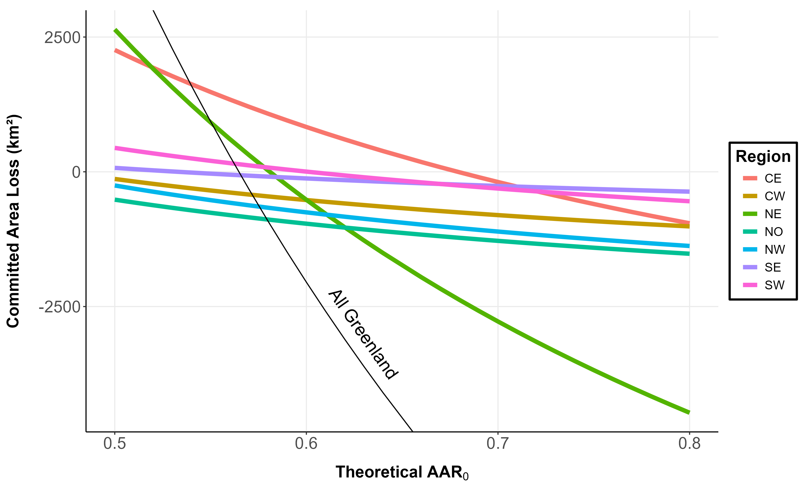

{#fig-poster-small fig-alt="AGU 2026 poster by Zalesky et al."}

## Methods {#sec-methods}
### Model Training and Validation {#sec-training}
\acr{ML} classification of Landsat images was based on a modified version of methods published by @Aberle_Enderlin_2025. Initial training data in the form of manually labeled glacier surface cover points and corresponding Landsat images were acquired courtesy of Aberle et al. for 4 USGS Benchmark glaciers (Gulkana, South Cascade, Sperry, and Wolverine) across 7 Landsat images, for a total of 8,162 training points. These labeled training points were augmented with an additional 2,650 training points within Greenland, for a combined total of 10,812 training points. For Greenland training data, two locations were chosen, Mittivakkat glacier in the south east, and a heavily glaciated rocky peninsula in the central west (72°N, 54°W; north of Disko Island). Additionally, the “cloud” class was added to the list of 5 landcover types from @Aberle_Enderlin_2025, bringing the total number of land cover classifications to 6, “cloud”, “ice/firn”, “rock”, “shadowed snow”, “snow”, and “water”. 

Surface reflectance Landsat 8 & 9 images were acquired for each of these training locations/dates via \acr{GEE}. Where multiple Landsat images overlapped within a 1-hour window for a single glacier (i.e. successive Landsat rows), images were merged using a median pixel value, as described by @Aberle_Enderlin_2025. For each training image five spectral indices were calculated to aid in image classification: \acr{NDGI}, \acr{NDSI}, \acr{NDVI}, \acr{NDWI}, and \acr{NSDS} (Equations -@eq-ndgi to -@eq-nsds). Each of these indices was tested individually and in combination with the other bands/indices and was found to aid separation of one or more of the landcover classes of interest. Surface reflectance, surface temperature, and all 5 spectral indices data were extracted from pixel data at each of the labeled training data points (Figures -@fig-fingerprint-SR & -@fig-fingerprint-indeices). 

$$
  NDGI = \frac{green - red}{green + red}
$${#eq-ndgi}

$$
  NDSI = \frac{green - SWIR_1}{green + SWIR_1}
$${#eq-ndsi}

$$
  NDVI = \frac{NIR - red}{NIR + red}
$${#eq-ndvi}

$$
  NDWI = \frac{green - NIR}{green + NIR}
$${#eq-ndwi}

$$
  NSDS = \frac{SWIR_1 - SWIR_2}{SWIR_1 + SWIR_2}
$${#eq-nsds}

{#fig-fingerprint-SR fig-alt="Spectral fingerprint boxplot"}

{#fig-fingerprint-indeices fig-alt="Spectral fingerprint boxplot"}

For model training and testing a K-folds repeated cross-validation method was utilized with 10 folds, 10 repeats, and a partition (p) = 0.9 resulting in a 90/10 training/testing split, where all labeled data points are utilized in testing for exactly 1 of 10 folds/repeats. Using this training/testing framework a total of 129 distinct \acr{ML} models were tested, across 10 model types, using a hyper-parameter grid search performed in R utilizing the caret package [@Kuhn_2008]. Based on the accuracy results of this training/testing model optimization process, the three best performing models were selected for additional model validation using previously unseen, spatially-temporally distant validation data. The top three, best performing models were, random forest, \acr{SVM} using a radial kernel, and \acr{SVM} with a linear kernel @tbl-hyperparams.

| Model | Parameters | Testing Accuracy (k-folds) |
| :---- | :--------- | :------------------------: |
| Random Forest | mtry = 6 | 0.98 |
| Support Vector Machine | radial kernel; sigma = 1 and C = 8 | 0.98 |
| Support Vector Machine | linear kernel; C = 8 | 0.97 |

: The hyperparameters and testing accuracy for the three best performing machine learning models on k-folds training-testing data. {#tbl-hyperparams}

Due to the spatial autocorrelation of the training/testing data, K-folds methods are prone to over-inflating model accuracy with geospatial datasets. Therefore, it is best practice to validate spatial ML models using an additional dataset which is spatially-temporally distant from the training/testing data, and which has never been seen by the model. In our study, we labeled 5,750 Greenland-specific validation points for 5 locations, across 8 Landsat images. These locations were chosen for validation to capture a range of regional variability across the island. The five validation locations are, Mittivakkat glacier (3 dates/images; south east), north west peninsula (2), south east island (1; southern tip), Freya glacier (1; north east), and north (1; @fig-training-location).

{#fig-training-location fig-alt="Map of Greenland"}

The three best performing \acr{ML} models were retrained using 100% of the available training data (10,812 labeled points) and were further validated on previously unseen data. The overall accuracy of all models decreased between 1-8% from their prior K-folds accuracy but maintained a satisfactory ovrall accuracy. The best performing model on the validation data was the SVM linear model, with an overall accuracy of 93% (@fig-confusion). The F1 statistic (a measure of model performance) was 94% for snow and 91% for ice, the two most critical classes for accurate \acr{AAR} calculation.

{#fig-confusion fig-alg="A confusion matrix of prediction accuracy"}

### Land Cover Classification {#sec-lcc}
#### Data Acquisition {#sec-lcc-data}
Following model validation, all applicable Landsat 8 & 9 Collection 2 Level-2, Tier 1 surface reflectance Science Products images from 2015-2025 during the ablation season (JJAS) which contained at least one peripheral glacier were downloaded using either \acr{GEE} geedim python package or the \acr{USGS} EarthExplorer data portal. Images taken on ascending orbits, and images which only covered the Greenland ice sheet but did not contain any peripheral glaciers were excluded. In total, 20,562 unique images were downloaded (~17 TB).

#### Image Preprocessing and Classification {#sec-classification}
Landsat images and the pretrained \acr{SVM} model were uploaded to the \acr{ASU} \acr{Sol} for processing [@HPC_2023]. Raw Landsat images were initially converted to surface reflectance and surface temperature data using established scaling factors for the \acr{OLI} and \acr{TIRS} instruments respectively. Images were then masked to peripheral glaciers using a buffered version of the \acr{RGI} glacier outlines [@RGI_2023]. A secondary cloud mask was applied based on a modified version of the Antarctic cloud mask developed by @Moussavi_2020. After masking, the five indices were calculated as with the training dataset. 

Preprocessed images were classified according to the pretrained \acr{SVM} (linear) model. For each classified image, glaciers with at least 70% classification coverage were identified from the RGI data, by a spatial query with the classified image. For each of the glaciers identified the surface area for each landcover class was extracted from the classified image along with relevant image metadata using the R sf package [@sf_2018-009]. For each glacier observation the transient \acr{AAR} was calculated according to equations -@eq-snow-area to -@eq-trans-aar. Each glacier observation and associated calculations was appended to a data file, culminating in ~4.6 million glacier observations. This data file was downloaded for further post-processing.

$$
Total\:Snow\:Area\:(km^2) = snow + shadowed\:snow
$$ {#eq-snow-area}
$$
Total\:Glacier\:Area\:(km^2) = Total\:Snow\:Area + ice/firn
$$ {#eq-glacier-area}
$$
Transient\:AAR = \frac{Total\:Snow\:Area}{Total\:Glacier\:Area}
$$ {#eq-trans-aar}

### Postprocessing {#sec-postprocessing}
Glacier observation data was postprocessed in R using the data.table package for fast, efficient handling of large datasets [@R_2021; @data.table_2026]. Spatial data was handled using the sf package [@sf_2018-009]. 

#### Quality Control and Data Filtering {#sec-QC}
A variety of quality control and filtering steps were utilized to ensure that appropriate annual (end-of-season) \acr{AAR} values were identified from the transient \acr{AAR} dataset. First, glacier observations were filtered by their calculated glacier area. Then they were filtered by cloud cover, shadowed snow ratio, glacier size, glacier slope, and finally by date.

The first observation filtering process leveraged the glacier area to identify and screen poorly classified images. The glacier area is calculated according to @eq-glacier-area, and the glacier area ratio is standardized by dividing the glacier area by its \acr{RGI} glacier extent (circa 2000). Ideally, throughout the ablation season, the glacier area ratio is expected to vary smoothly from ~1 (spring; fully snow covered) to some minimum value (late summer; exposed ice and rock near terminous), followed by a rapid rebound (end of ablation; onset of seasonal snowfall). In practice a combination of cloudy images and poor image classification can drive the glacier area ratio down. To screen these poor-quality images a loess function was fit to the glacier area ratio data for each glacier-year. The residuals were calculated for each glacier observation, and observations with residuals < the 25^th^ percentile per glacier-year were filtered out (@fig-loess). 

{#fig-loess fig-alt="Scatterplot"}

Several additional simple filters were applied to the transient \acr{AAR} data according to AAR accuracy spot-checks and sensitivity analysis [@tbl-filters]. After all other filters were applied, the number of remaining quality glacier observations were counted for each glacier year. Glacier years which did not have at least 9 quality observations were removed (see @sec-observation-density).

| Variable | Filter | Data Source/Equation |
| :------- | :------- | :----------- |
| cloud cover | < 20% | $\frac{cloud\:area}{RGI\:area}$ |
| shadowed snow | < 50% | $\frac{shadowed\:snow\:area}{RGI\:area}$ |
| glacier area | > 1 km^2^ & < 300 km^2^ | RGI |
| slope | < 20° | RGI |
| day of year | < 259 (~Sep. 16^th^) | Landsat image metadata |
| n quality images | > 8 | filtered transient AAR data |

: Quality control filters applied to the transient \acr{AAR} dataset. {#tbl-filters}

#### Annual AAR determination {#sec-aar}
From this filtered transient \acr{AAR} dataset, the annual (end-of-season) \acr{AAR}  was identified as the minimum remaining transient \acr{AAR} value. (Hereafter, AAR is synonymous with annual AAR, transient AAR and $\overline{AAR}$ will be explicitly identified as appropriate.) After filtering 37,036 glacier-years had quality \acr{AAR} data.

#### Mean AAR {#sec-mean-aar}
The glacier-specific mean \acr{AAR} ($\overline{AAR}$) was calculated as the arithmetic mean of \acr{AAR} for glaciers which had at least 5 years of AAR data. In total, 3,679 glaciers had quality $\overline{AAR}$ data.

### Glacier-Year Observation Density Sensitivity Analysis {#sec-observation-density}
To quantify the number of quality images needed for accurate identification of the \acr{AAR}, an observational density experiment was performed. Twenty-one well-observed glacier-years were identified, evenly distributed around Greenland, each with at least 30 quality glacier observations (post filtering). For each glacier a series of subseting experiments was performed where n randomly selected points were subset from the glacier-year data. Using the randomly subset data, the assessed \acr{AAR} was selected from the artificially limited dataset and compared against the actual (known) \acr{AAR} obtained from the full dataset. The n observations tested were 3, 5, 7, 9, 12, 15, 20, 25, 30, and each experiment was repeated 100 times, for a total of 18,900 simulations [@fig-obs-dense]. Based on the resultus of these simulations, at least 9 quality observations per year are needed to reliably identify the \acr{AAR} [@tbl-obs-dense].

{#fig-obs-dense fig-alt="Violin plot with points."}

| n Quality Observations | Mean AAR Error | Median AAR Error |
| :--------------------- | -------------: | ---------------: |
| 3 | -0.266 | -0.190 |
| 5 | -0.188 | -0.126 |
| 7 | -0.143 | -0.083 |
| 9 | -0.114 | -0.045 |
| 12 | -0.094 | -0.027 |
| 15 | -0.067 | -0.019 |
| 20 | -0.044 | -0.007 |
| 25 | -0.030 | 0 |
| 30 | -0.018 | 0 |

: Mean and median AAR error rates for the observation density sensitivity analysis (2,100 simulations per subset).  {#tbl-obs-dense}

### Equilibrium AAR and Committed Area Loss {#sec-aar0}
Equilibrium AAR (AAR~0~) values were estimated after @Kern_László_2010. Disequalibrium ($\alpha$) and committed area loss ($\Delta$A) were calculated according to @Box_Hubbard_2022. The $\Delta$A values varried considerably by region, with the \acr{NO} and \acr{NE} having the most committed area loss. However, the \acr{NO}, \acr{NW}, and \acr{CW} have the most committed area loss relative to their current glaciated extent, at 34%, 27% and 24% respectively. Furthermore, while the resulting $\Delta$A values are approximately centered on 0 (median = -0.3 km^2^) the distribution is not normal (@fig-delta-a-dist). Rather, the distribution is highly leptokurtic (kurtosis = 90.3), with a negative skew (skew = -5.2). This indicates that, while most glaciers contribute relatively little to Greenland's cumulative committed retreat, a few large glaciers that are substantially out of balance with current climate conditions are contributing the majority of the projected area loss. Similarly, a relatively few large glaciers are dominating the $\Delta$A calculations on the positive side, particularly in the \acr{CE}.

{#fig-delta-a-dist fig-alt="A histogram"}

#### Committed Area Loss Sensitivity Analysis {#sec-delta-a-sensitivity}
To further investigate the $\Delta$A results we conducted a sensitivity analysis for a range of plausible AAR~0~ values, from 0.5 to 0.8, for each region individually as well as for Greenland as a whole (@fig-delta-a-sensitivity). While most regions exhibited relatively low sensitivity to AAR~0~ values, the \acr{NE} and \acr{CE} were both highly sensitive to a wide range of AAR~0~ values. Therefore, small differences in either $\overline{AAR}$ or AAR~0~ in these two regions would result in relatively large changes to $\Delta$A. 

{#fig-delta-a-sensitivity fig-alt="A line plot"}

#### Review of Yang et al. AAR~0~ Estimates
An alternative and recently published approach to AAR~0~ estimates offered by @Kern_László_2010 is the glacier-specific AAR~0~ values published by @Yang_Mackintosh_2026. While the @Yang_Mackintosh_2026 data is laudible, and one of the only glacier-specific AAR~0~ datasets available, it may not be well suited for use in Greenland. While we initially favored the @Yang_Mackintosh_2026 estimates, the resultant $\alpha$ and $\Delta$A calculations did not pass scruitany. The cumulative Greenland $\Delta$A utilizing the Yang et al. data was a positive glacier area change of ~3,000 km^2^, with many glaciers showing $\alpha$ values > 1. Upon further investigation, we found that our $\overline{AAR}$ classification and calculation methods were accurate, the $\alpha$ > 1 calculations were largely being driven by implausably small AAR~0~ values. For example, consider this large glacier in the \acr{NW} (RGI2000-v7.0-G-05-00250; @fig-glacier). This glacier is the most extreme example of a positive $\Delta$A in the dataset. With an $\overline{AAR}$ of 0.63 and a realized area loss of < 2\% from circa 2020 to 2025 this glacier appears to be relatively healthy. However, the @Yang_Mackintosh_2026 data list the AAR~0~ for this glacier as 0.45, a shockingly low estimate. In fact, of the top 10 most positive $\Delta$A glaciers in our data (as calculated with the Yang et al. data), 7 of them have AAR~0~ values < 0.5 (the losest tested theoretical AAR~0~ value in our sensitivity analysis). Global paleio-climate AAR~0~ estimates are typically estimated as 0.58, therefore, values below 0.5 are quite low. Additionally, ice caps, as seen in our representative example, typically have larger AAR~0~ values, relative to equivalent mountain glaciers [@Yang_Mackintosh_2026; @Kern_László_2010]. 

{#fig-glacier fig-alt="A large glacier, part of a ice cap (a.k.a. a glacier complex)"}

These results call into question the accuracy of the @Yang_Mackintosh_2026 data within Greenland. Therefore, alternate AAR~0~ estimates were identified, and the @Kern_László_2010 appeared to be a better fit for our study area. The updated $\Delta$A calculations using the Kern and László data shift cumulative Greenland committed area loss into negative teratory, matching well understood and widely observed global trends of glacial retreat, and $\Delta$A forecasts are roughly equivalent (equal order of magnitude) with actualized (observed) loss from 2000–2025. Overall, the @Kern_László_2010 estimates provide much more defensible results of projected area change within Greenland, however, their AAR~0~ estimates only considered glaciers up to ~40 km^2^, ~7 times smaller than our largest glacier. Therefore, we present $\Delta$A values preliminaraly and caution against granular analysis of glacier-specific $\Delta$A.

## References {.unnumbered}

::: {#refs}
:::